# Credit Card Fraud Detection on 34.6M Transactions


An end-to-end data science project: exploratory analysis, a fraud classifier, a Streamlit app, and an MLOps pipeline with
Airflow, MLflow and Docker. The goal is to **score every transaction at authorization time**, so the fraud team reviews
only the highest-risk ones.

> **The data is synthetic.** There are clear signs of it (no fraud above ~US$ 1,250, cardholders aged 16 and 17 with a credit
> card, an identical weekly purchase cycle in November). The numbers in this project are **not** real-world estimates.
>
> Note: the chart labels inside the images are in Portuguese; the explanations around them are in English.

## Table of contents

1. [The problem](#1-the-problem)
2. [Results at a glance](#2-results-at-a-glance)
3. [The data](#3-the-data)
4. [Exploratory analysis insights](#4-exploratory-analysis-insights)
5. [Modeling and model results](#5-modeling-and-model-results)
6. [Streamlit app](#6-streamlit-app)
7. [MLOps: Airflow, MLflow and Docker](#7-mlops-airflow-mlflow-and-docker)
8. [How to run](#8-how-to-run)
9. [Project structure](#9-project-structure)
10. [Limitations and next steps](#10-limitations-and-next-steps)
11. [Tech stack and license](#11-tech-stack-and-license)

---

## 1. The problem

Credit card fraud causes direct losses (chargebacks and reimbursements), manual review costs and loss of customer trust.
It is a **rare** event (about 0.55% of transactions), so fixed rules and manual review of everything do not scale.

The business needs a model that scores each transaction and balances two costs:

- **False negative:** a missed fraud costs the full purchase amount.
- **False positive:** a legitimate purchase blocked or sent to review costs friction, call-center time and churn risk.

**Main metric: PR-AUC.** Predicting "not fraud" for everything already gives ~99.5% accuracy, so accuracy and ROC-AUC alone
are misleading. The final decision uses **cost**: value of the frauds that got through + US$ 10 per false alarm (an assumption).

## 2. Results at a glance

Current model: **Random Forest** (200 trees, depth 6) with a decision threshold of **0.395**, chosen by cost.
Test set: 1,358,891 transactions (Aug 14 to Dec 23, 2020), 7,042 frauds (0.52%).

| Scenario on the test set | Frauds caught | Missed | False alarms | Cost (US$) |
|---|---:|---:|---:|---:|
| No model | 0 | 7,042 | 0 | 3,810,073 |
| Original Random Forest, 0.5 cutoff | 4,985 | 2,057 | 120,011 | 1,446,207 |
| Tuned, 0.5 cutoff | 4,843 | 2,199 | 102,030 | 1,290,984 |
| **Tuned, cost-based cutoff (0.395)** | **4,997** | **2,045** | **108,357** | **1,298,802** |

- Catches about **71%** of the frauds, with **~4% precision** (about 22 false alarms per fraud caught).
- Cuts the cost by **~66%** compared with having no model.
- On the test set, the cost-based cutoff (chosen on validation) ended up 0.6% above the 0.5 cutoff cost: the difference is small.
- **The purchase amount carries almost all of the signal**: using `amt` alone as a score already gives a test PR-AUC of 0.1526,
  against 0.2835 for the Random Forest (and 0.3366 against 0.3625 on validation).

## 3. The data

- **Dataset:** `credit_card_fraud.csv`, ~10.7 GB, **34,636,378 transactions** from December 2018 to December 2020. The file
  lives in `input/` and is not tracked by git.
- **Fraud rate:** 0.548%. Total fraud loss is close to US$ 100 million.
- **Incomplete labels at the end:** the last day with recorded fraud is Dec 25, 2020, so the analysis and the model use data
  only up to Dec 23, 2020 (33,974,423 transactions). Without this cutoff the test set would have missing labels.
- **Privacy:** the dataset has personal columns (`ssn`, `cc_num`, name, address). The model and the app **never read them**.
- **Model features (9):** `amt`, `city_pop`, `lat`, `long`, `merch_lat`, `merch_long` (numeric) and `category`, `gender`,
  `state` (categorical). No engineered features.

## 4. Exploratory analysis insights

Notebook: [`notebook/Credit_Card_Fraud_Mega___Exploratory_Data_Analysis.ipynb`](notebook/Credit_Card_Fraud_Mega___Exploratory_Data_Analysis.ipynb)
(an exported version is in [`py/`](py/)).

### 4.1 Fraud is rare by count but heavy in money

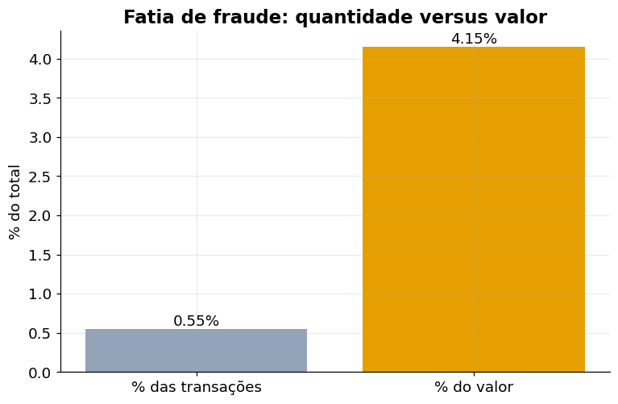

Fraud is **0.55% of transactions** but **4.15% of the money** moved: the average fraud ticket is about **7.5 times** the overall
ticket. Few frauds still means a lot of lost money.

### 4.2 The purchase amount is the strongest signal

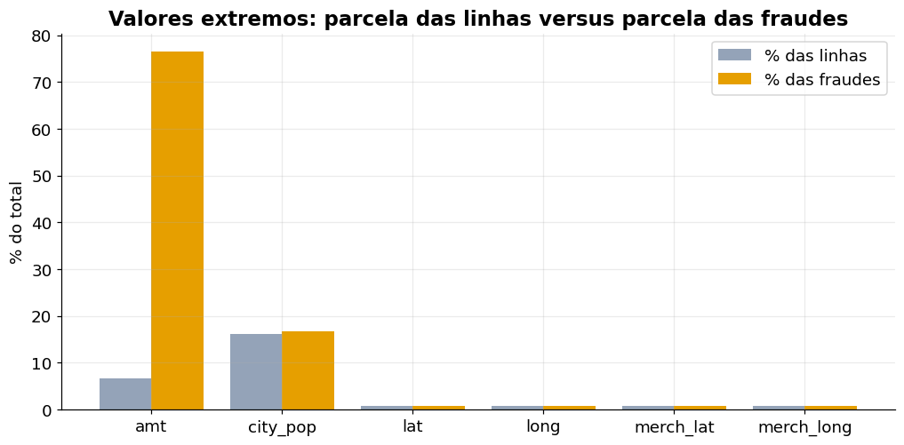

Only ~6.5% of rows have an extreme `amt`, but they hold **~76% of the frauds**. For city population the two sides are similar,
and for latitude and longitude there is no difference. By amount band, the fraud rate is:

| Purchase amount | Fraud rate |
|---|---:|
| Below US$ 250 | close to zero |
| US$ 250 to 500 | ~7% |
| US$ 500 to 1,000 | ~23% |
| US$ 1,000 to 5,000 | ~21% |

These three bands hold **3% of the transactions and about three quarters of the frauds**.

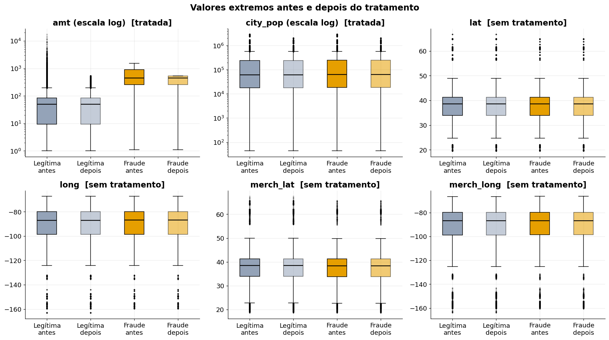

The median fraud is around US$ 450, against ~US$ 50 for legitimate purchases. The chart shows before and after the outlier
treatment: only `amt` and `city_pop` were treated (log scale); the coordinates did not need it.

### 4.3 The loss is concentrated in a few merchants

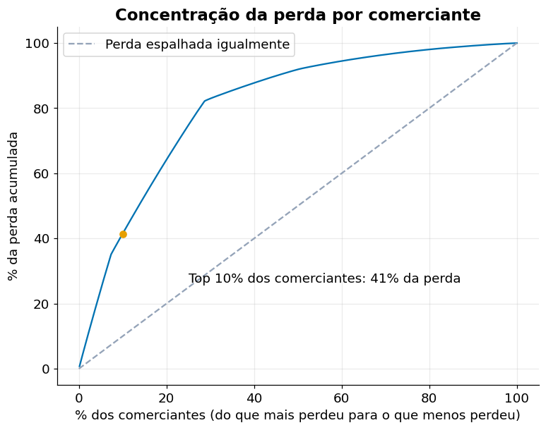

Among 693 merchants, the **top 10% account for 41% of the loss**, and about 28% of them account for 82%. Watching the merchants at
the top of the curve covers most of the money lost.

### 4.4 Categories: loss and risk are not the same thing

- **Four categories hold ~80% of the loss:** `shopping_net`, `shopping_pos`, `misc_net` and `grocery_pos`.
- The **highest risk** is in `shopping_net` (1.7%), `misc_net` (1.6%) and `grocery_pos` (1.3%).
- `shopping_pos` is second in loss but has a 0.7% risk: the money lost there comes from purchase **volume**, not from a higher chance of fraud.

### 4.5 Who: age matters, gender barely does

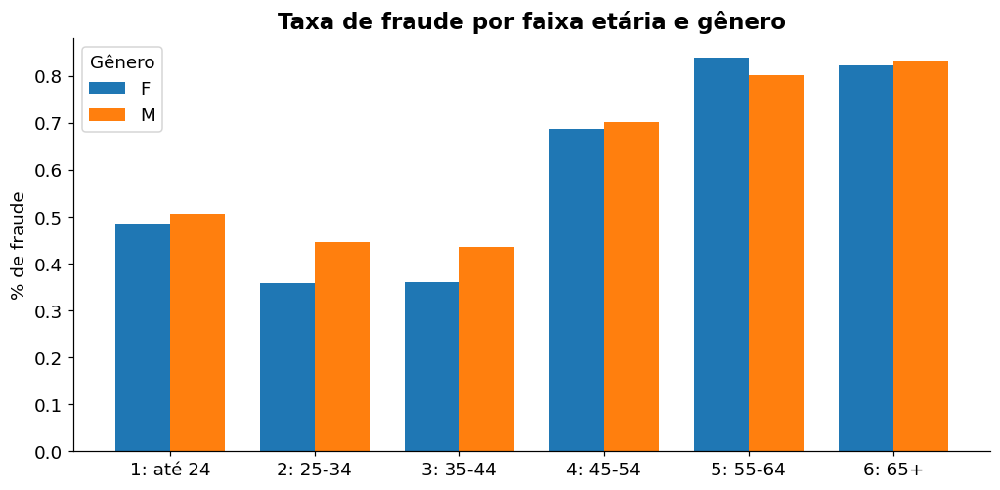

Customers **aged 45 or more** have a rate about **twice as high** (0.7% to 0.8%, against 0.35% to 0.44% for ages 25 to 44).
The difference between genders is below 0.1 percentage point. Age may reflect purchasing profile rather than being the factor itself.

### 4.6 When: fraud has its own rhythm and does not follow volume

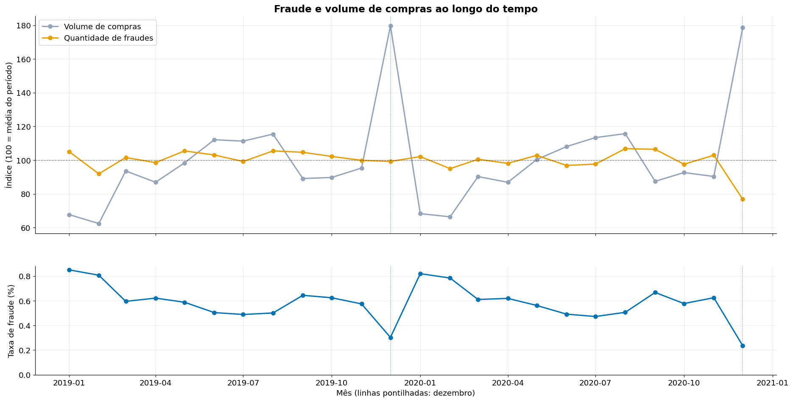

There are 7,300 to 8,400 frauds per month, while purchase volume ranges from 0.9 to 2.6 million per month and **doubles in December**.
The fraud rate drops in December (~0.3%) and rises in January (~0.8%) **only because the denominator changes**, with no real change
in fraud. So the rate must be read together with volume, and monitoring should track fraud count and amount.

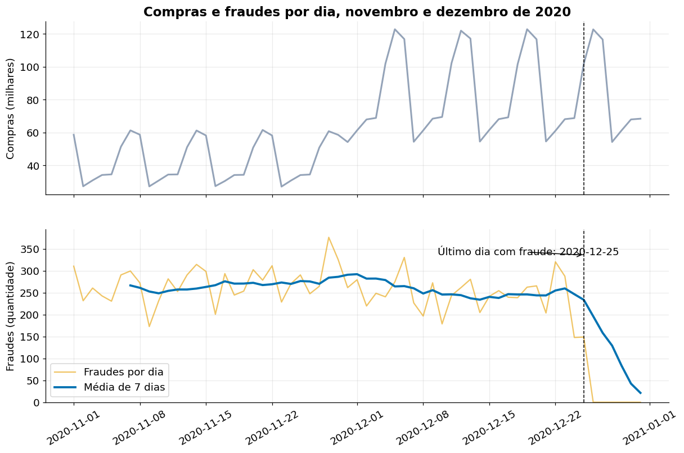

Day by day, purchases follow an identical weekly cycle (from ~27 thousand on Mondays to ~60 thousand on weekends, doubling in
December), while frauds stay around **250 per day** on any day. The chart also shows the **end of the labels on Dec 25, 2020**: after
that, purchases continue but the fraud count falls to zero. That is the reason for the Dec 23 cutoff.

### 4.7 Other findings

- **End-of-day risk window:** the rate stays near 0.1% from hour 0 to 15, reaches ~2.5% at hour 17 and returns to 0.1% at hour 23.
  The pattern does not come from volume. Hours are in UTC and still need to be confirmed against the original time zone.
- **Customer-to-merchant distance does not separate fraud from legitimate purchases:** the median is ~79 km in both groups.
- Customer and merchant **latitude and longitude** correlate at 0.99 to 1.00.

### 4.8 Recommendations for the fraud team

1. **Prioritize review by amount.** Reviewing every purchase between US$ 250 and 5,000 would cover ~75% of the frauds, but with only
   ~13% precision (1 fraud for every 8 purchases reviewed). The amount rule orders the queue and the model refines which to review first.
2. **Monitor fraud count and amount**, and use the rate only together with volume.
3. **Size the team by the steady load** (~8 thousand cases per month), not by the shopping calendar.
4. **Follow the merchants at the top** of the concentration curve.
5. **Do not invest in distance rules:** in this dataset distance does not tell fraud from legitimate purchases.

## 5. Modeling and model results

Notebook: [`notebook/Credit_Card_Fraud_Mega___Model_ML.ipynb`](notebook/Credit_Card_Fraud_Mega___Model_ML.ipynb).

### 5.1 Method

1. **20% sample:** one of every 5 transactions (by hash), which keeps the real fraud rate.
2. **Chronological split, no shuffling:** test = last 20% of the sample; of the rest, the last 20% is validation. The test set comes after
   training in time, as it would in production. (The same customer can appear in several parts.)
3. **1:10 undersampling in the fit part only** (10 legitimate transactions per fraud, 9.1% fraud). Validation and test keep the real rate.
4. **10 algorithms compared** with fixed parameters (Logistic Regression, Decision Tree, Random Forest, Extra Trees, LightGBM,
   HistGradientBoosting, XGBoost, XGBoost RF, CatBoost, Gaussian Naive Bayes).
5. **Random search** of hyperparameters (score = validation PR-AUC) and a **cost-based threshold** chosen on validation.
6. **Evaluation on the test set**, which takes part in no choice.

### 5.2 Comparison of the 10 algorithms (test set)

Random baseline PR-AUC: 0.0052. The cutoff-0.5 columns come from the confusion matrices in the next section.

| Model | PR-AUC | ROC-AUC | TP | FP | FN | TN | Precision | Recall | Alerts |
|---|---:|---:|---:|---:|---:|---:|---:|---:|---:|
| **Random Forest** | **0.2835** | 0.886 | 4,985 | 120,011 | 2,057 | 1,231,838 | 0.040 | 0.708 | 124,996 |
| Gaussian Naive Bayes | 0.1523 | 0.824 | 3,576 | 14,647 | 3,466 | 1,337,202 | 0.196 | 0.508 | 18,223 |
| Logistic Regression | 0.1512 | 0.818 | 3,467 | 10,698 | 3,575 | 1,341,151 | 0.245 | 0.492 | 14,165 |
| XGBoost RF (GPU) | 0.0372 | 0.896 | 5,852 | 229,308 | 1,190 | 1,122,541 | 0.025 | 0.831 | 235,160 |
| Decision Tree | 0.0215 | 0.877 | 5,258 | 186,691 | 1,784 | 1,165,158 | 0.027 | 0.747 | 191,949 |
| XGBoost (GPU) | 0.0187 | 0.842 | 5,281 | 307,639 | 1,761 | 1,044,210 | 0.017 | 0.750 | 312,920 |
| LightGBM | 0.0177 | 0.836 | 5,299 | 328,595 | 1,743 | 1,023,254 | 0.016 | 0.752 | 333,894 |
| HistGradientBoosting | 0.0176 | 0.834 | 5,301 | 349,355 | 1,741 | 1,002,494 | 0.015 | 0.753 | 354,656 |
| Extra Trees | 0.0142 | 0.636 | 3,304 | 285,133 | 3,738 | 1,066,716 | 0.011 | 0.469 | 288,437 |
| CatBoost (GPU) | 0.0057 | 0.582 | 5,279 | 668,849 | 1,763 | 683,000 | 0.008 | 0.750 | 674,128 |

Using the raw purchase amount as the score, with no model, gives a **PR-AUC of 0.1526** and a ROC-AUC of 0.8467.

- **Random Forest leads on PR-AUC** (0.2835, about 54 times the random baseline). Gaussian Naive Bayes and Logistic Regression follow.
- **Only Random Forest beats the amount-only reference (0.1526).** Gaussian Naive Bayes (0.1523) and Logistic Regression (0.1512) essentially tie it,
  which means they mostly replicate the "amount" rule, and the other seven models are far below it.
- **Ranking and decision are different things.** At the 0.5 cutoff the aggressive models flag between 190 thousand and 674 thousand
  transactions, while Logistic Regression and Naive Bayes flag only 14 to 18 thousand.

### 5.3 Confusion matrices (0.5 cutoff, test set)

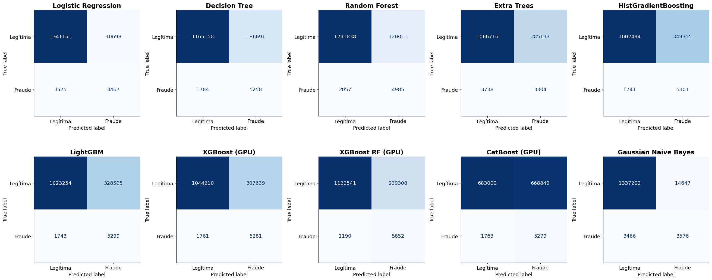

Rows are the real class, columns the predicted class (the labels are in Portuguese: *Legítima* = legitimate, *Fraude* = fraud).
All ten models catch 47% to 83% of the frauds, but at very different costs in false alarms: Logistic Regression and Naive Bayes
raise ~11 to 15 thousand false alarms, Random Forest ~120 thousand, and CatBoost ~669 thousand, which is half of all legitimate transactions.
The matrices compare decision rules, not ranking ability.

### 5.4 ROC curves

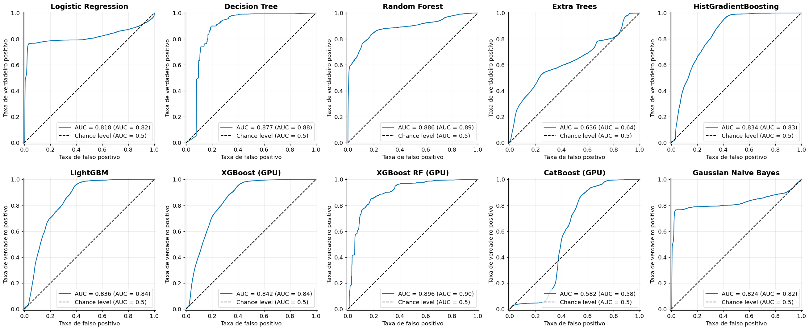

- **ROC ranks the models differently from PR-AUC**, and that gap is the main finding. XGBoost RF has the highest ROC-AUC (0.896) but a PR-AUC of only
  0.037. Random Forest has the highest PR-AUC and is second in ROC (0.886).
- **Eight of the ten models have a ROC-AUC above 0.81, but seven of them have a PR-AUC below 0.04.** With a 0.5% fraud rate, a small false positive
  rate still means many false alarms: a point with TPR = 0.80 and FPR = 0.10 gives a precision of only ~4% here.
- Extra Trees (0.636) and CatBoost (0.582) are close to random on this task.

### 5.5 Classification report (same alert volume for every model)

To compare models fairly, each model flags the same number of transactions: its **7,773 highest scores** (the test set size times the
training-period fraud rate). Accuracy is about 0.99 for everyone, so the **fraud-class** line is the one that matters.

| Model | Fraud precision | Fraud recall | Fraud F1 |
|---|---:|---:|---:|
| **Random Forest** | **0.3607** | **0.3982** | **0.3785** |
| Logistic Regression | 0.2848 | 0.3144 | 0.2989 |
| Gaussian Naive Bayes | 0.2811 | 0.3103 | 0.2950 |
| Extra Trees | 0.0172 | 0.0190 | 0.0181 |
| LightGBM | 0.0112 | 0.0124 | 0.0117 |
| XGBoost (GPU) | 0.0090 | 0.0099 | 0.0094 |
| HistGradientBoosting | 0.0084 | 0.0092 | 0.0088 |
| Decision Tree | 0.0048 | 0.0053 | 0.0050 |
| CatBoost (GPU) | 0.0048 | 0.0053 | 0.0050 |
| XGBoost RF (GPU) | 0.0017 | 0.0018 | 0.0018 |

Full report for the best model:

```text
Random Forest
              precision    recall  f1-score   support

    Legitima     0.9969    0.9963    0.9966   1351849
      Fraude     0.3607    0.3982    0.3785      7042

    accuracy                         0.9932   1358891
   macro avg     0.6788    0.6973    0.6876   1358891
weighted avg     0.9936    0.9932    0.9934   1358891
```

When the alert volume is capped at the same level for every model, **only Random Forest, Logistic Regression and Naive Bayes keep a useful precision**
(0.28 to 0.36, about 55 to 70 times the random baseline). Random Forest is first, but its lead over the two simple models is moderate, and with a
single test set it should not be called clear.

### 5.6 Tuning, cost-based threshold and the final model

The Random Forest was tuned with a random search (8 combinations, scored by validation PR-AUC: **0.3625**) and the threshold was chosen on
validation to minimize cost (**0.395**, validation cost US$ 343,750 against US$ 382,488 at the 0.5 cutoff and US$ 3,054,052 with no model).


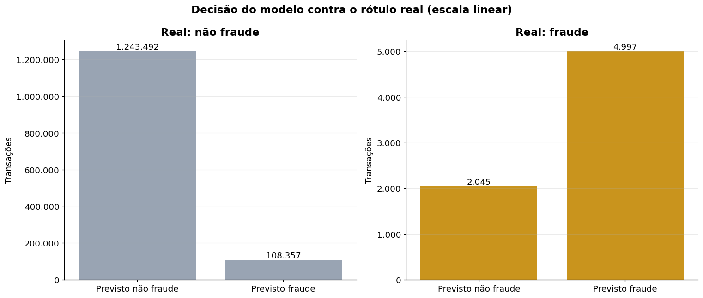

| Test set | Frauds caught | Missed | False alarms | Precision | Recall | F2 | Cost (US$) |
|---|---:|---:|---:|---:|---:|---:|---:|
| Original (0.5 cutoff) | 4,985 | 2,057 | 120,011 | 0.0399 | 0.7079 | 0.1627 | 1,446,207 |
| Tuned (0.5 cutoff) | 4,843 | 2,199 | 102,030 | 0.0453 | 0.6877 | 0.1793 | 1,290,984 |
| Tuned + cost-based cutoff | 4,997 | 2,045 | 108,357 | 0.0441 | 0.7096 | 0.1765 | 1,298,802 |

The cutoff drives the result as much as the model does. The cost-based threshold is a decision rule that depends on the assumed US$ 10 per false
alarm, and the differences between the tuned versions are small.

### 5.7 Feature importance

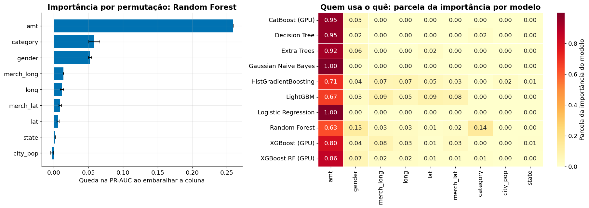

Shuffling `amt` drops the Random Forest PR-AUC by about 0.26, which is nearly all of its test score. `category` and `gender` follow, and
coordinates and population matter little for Random Forest (and more for boosting models). Customer and merchant coordinates are almost perfectly
correlated, so shuffling one lets the other cover for it, and the location signal is underestimated when each column is read alone.

### 5.8 SMOTENC was tested and not adopted

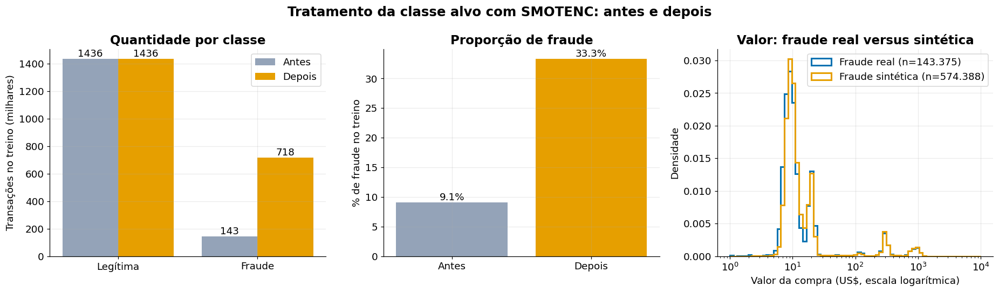

SMOTENC raised the fraud share from 9.1% to 33.3% of the training set (143 thousand real + 574 thousand synthetic frauds), and the amount distribution
of the synthetic frauds mimics the real one. But the validation PR-AUC was only **0.0091**, close to the random baseline (0.0053). The final model
uses the 1:10 undersampling instead.

## 6. Streamlit app

```bash
streamlit run app/streamlit_app.py
```

| Tab | What it does |
|---|---|
| **Single transaction** | Fill in the 9 fields and see the risk score, the decision (alert or release), the gauge with the threshold, and how the purchase amount changes the score |
| **Batch analysis (CSV)** | Upload a CSV (up to 300,000 rows) and see alerts, review cost, the **map by customer location**, the score distribution and the highest-risk transactions. With an `is_fraud` column it also measures recall, precision and cost |
| **About the model** | Problem, method, test results and limitations |

(The app interface itself is in Portuguese.)

- **Map:** two modes. *Risk score (0 to 1)* works with any CSV. *Result: fraud x false alarm* (adapted from the notebook) needs `is_fraud`:
  orange = fraud caught, gray = false alarm, and the bubble size is the number of alerts at the location.
- **Local dataset:** if `input/credit_card_fraud.csv` exists, a button draws N transactions from it (only the model columns and `is_fraud` are read).
- **Upload validation:** invalid rows are dropped and listed; the app warns about categories the model does not know.
- **Deploy:** works on Streamlit Community Cloud (main file `app/streamlit_app.py`, Python 3.12). Details in [doc/app-streamlit.md](doc/app-streamlit.md).

> The score is **not a calibrated probability**: training used undersampling. It is meant to rank risk.

## 7. MLOps: Airflow, MLflow and Docker

```
 input/credit_card_fraud.csv
        │
        ▼
 Airflow: validate_base → convert_parquet → prepare_sample → split_data → train_evaluate → promote
                                                                              │                │
                                                                              ▼                ▼
                                                                 MLflow (metrics, model)   mlflow/producao/modelo_final.joblib
                                                                 registry + champion alias          │
                                                                                                    ▼
                                                                                              Streamlit app
```

- **DAG** `fraude_cartao_pipeline` ([`airflow/dags/fraude_pipeline.py`](airflow/dags/fraude_pipeline.py)): reproduces the notebook method, is triggered
  manually and has parameters (search iterations, false alarm cost, sample size, promotion rule).
- **MLflow:** logs parameters, validation and test metrics, the model and a bundle in the app's format. Each version goes to the
  `fraude_cartao_random_forest` registry, and the `champion` alias points to the version in production.
- **Promotion:** a new model becomes champion only if it has a **lower test cost** than the current one. When promoted, the bundle is published to
  `mlflow/producao/` and the app starts using it.
- **Docker Compose:** Postgres, MLflow, Airflow (webserver and scheduler) and the app, in [`docker/`](docker/).

Ports: Airflow `8080`, MLflow `5000`, app `8501`. Step by step in [doc/guia-docker.md](doc/guia-docker.md). The detailed documentation in [`doc/`](doc/README.md)
is written in Portuguese.

## 8. How to run

### 8.1 Just the app

```bash
python -m venv .venv
.venv\Scripts\activate            # Linux/macOS: source .venv/bin/activate
pip install -r requirements.txt
streamlit run app/streamlit_app.py
```

`requirements.txt` pins `scikit-learn==1.5.2`, the series that saved the model. Another version loads the model with a warning and may diverge.

### 8.2 The notebooks

Put `credit_card_fraud.csv` in `input/` and open the notebooks in `notebook/`. They use paths relative to the project root.
**Warning:** running the whole modeling notebook **overwrites** the files in `models/`, including `modelo_final.joblib`, which the app uses.
To retrain without touching `models/`, use the `executar_notebook.py` runner, which writes its outputs to `retreino/`.

### 8.3 Airflow, MLflow and app on Docker

```bash
cd docker
cp .env.example .env              # edit the passwords and AIRFLOW_FERNET_KEY
docker compose up --build
```

Then open Airflow at http://localhost:8080, trigger the `fraude_cartao_pipeline` DAG and follow it at http://localhost:5000.

### 8.4 Deploying the app on Streamlit Community Cloud

1. Push to GitHub what the app needs (the `.gitignore` already blocks the ~10 GB CSV and the heavy models).
2. On [share.streamlit.io](https://share.streamlit.io), create the app with the `main` branch and the main file `app/streamlit_app.py`.
3. Under **Advanced settings**, select **Python 3.12**.

## 9. Project structure

```
.
├── app/streamlit_app.py            # interface (3 tabs)
├── src/
│   ├── modelo.py                   # model loading, batch validation, prediction, metrics
│   ├── mapa.py                     # bubble maps by customer location
│   └── pipeline_treino.py          # training pipeline steps (used by the DAG)
├── airflow/dags/fraude_pipeline.py # Airflow DAG
├── docker/                         # docker-compose, Airflow and app images, .env.example
├── mlflow/                         # MLflow server image and producao/ (champion model)
├── notebook/                       # EDA and modeling
├── py/                             # EDA exported as .py
├── models/modelo_final.joblib      # final model (the other files in models/ stay on your machine)
├── output/transacoes_novas.csv     # 5,000 sample transactions for the app
├── input/                          # dataset (not tracked by git)
├── img/                            # charts used in this README
├── doc/                            # detailed documentation (Portuguese)
└── requirements.txt
```

## 10. Limitations and next steps

**Limitations**

- **Synthetic data:** the patterns are sharper than in real life, and the numbers are not real-world estimates.
- **A single data split and a fixed seed**, with a search of only 8 combinations. Retrained models vary: an earlier version (trained on Colab,
  300 trees, threshold 0.85) had 31,314 false alarms against 108,357 for the current one, with a similar number of frauds caught.
- **The test set was used more than once** when comparing the models.
- **US$ 10 per false alarm is an assumption**, and the threshold and the savings depend on it.
- **The data shows association, not causation.**

**Next steps**

- Confirm the time zone of the hours (UTC) and test hour and amount band as model features.
- Time-based cross-validation and a wider hyperparameter search.
- Calibrate the scores to obtain probabilities.
- Schedule the DAG and monitor data drift.
- Test the full stack on Docker and publish the images.

## 11. Tech stack and license

Python 3.12, polars, pandas, scikit-learn, XGBoost, LightGBM, CatBoost, imbalanced-learn, Plotly, Streamlit, Apache Airflow, MLflow, Docker and PostgreSQL.

Licensed under the [MIT License](LICENSE). Author: Rafael Gallo.
